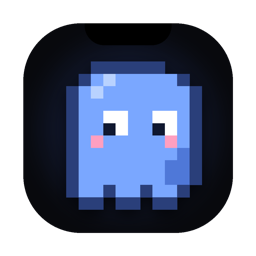
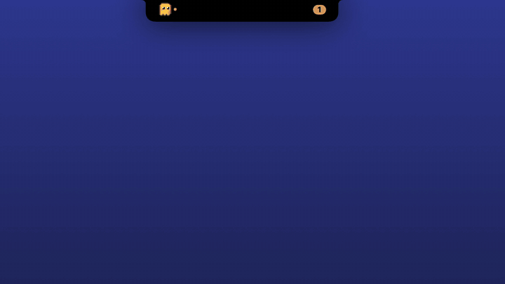
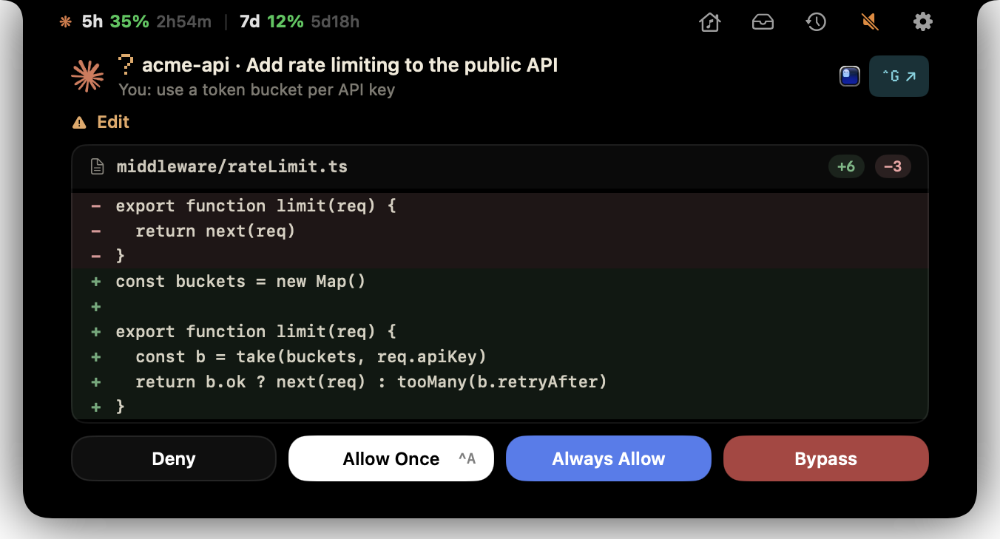
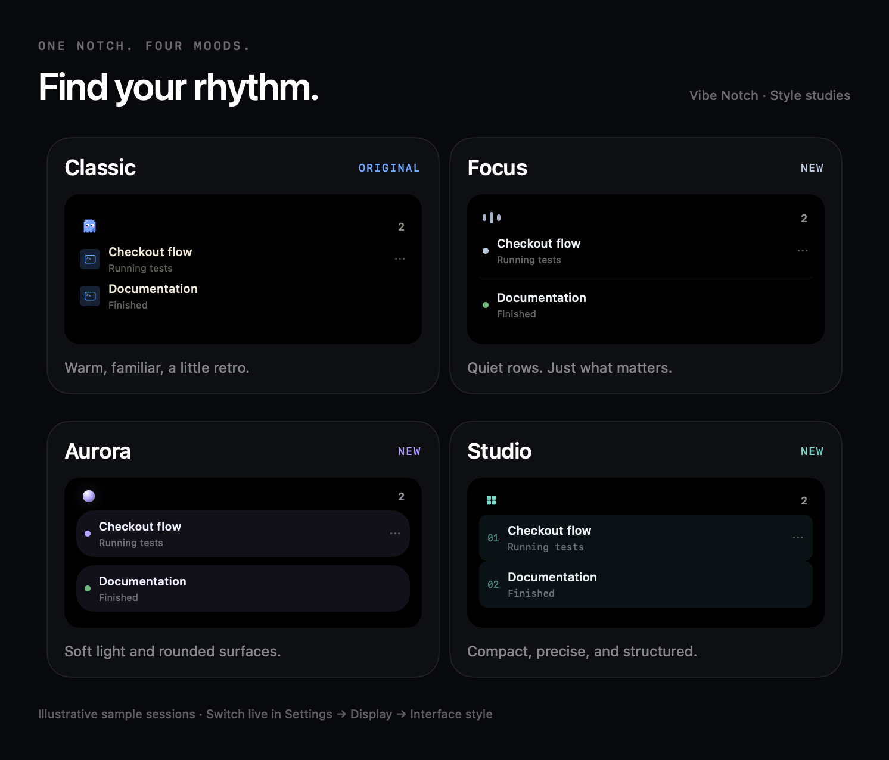

<div align="center">


# Vibe Notch

Keep your coding agents in sight.

A native Mac app that brings agent activity, permission requests, and questions to your notch.

[macOS 14+](#requirements) · Apple Silicon · Swift 6 · [GPL-3.0](LICENSE)


</div>

## Public beta

**0.4.0-beta.1** is distributed as an explicitly unsigned beta from [tryvibenotch.com](https://tryvibenotch.com). It is ad-hoc signed, not Developer ID signed or notarized. macOS may block first launch because Apple cannot verify the developer. A signed release is planned later. Files named `LOCAL-PREVIEW` remain local validation builds.

Keep the agent terminal available during the beta. Hook support, question delivery, and terminal navigation vary by agent version and terminal. Please report the agent version, macOS version, display model, and steps to reproduce when filing an issue. Redact prompts, commands, paths, and credentials from screenshots and logs.

## What it does

- **Activity at a glance.** See working, waiting, completed, interrupted, failed, and inactive sessions, with a short local event timeline.
- **Permissions with context.** Review commands and supported file diffs, then allow or deny. Risk labels are hints; review the action yourself.
- **Questions in place.** Show supported Claude and Codex questions. Queued Codex answers go to the exact thread through its local daemon, and the card advances after delivery is acknowledged. Superseded questions expire as the transcript advances.
- **Four looks.** Classic is the default; Focus, Aurora, and Studio change the panel styling. Choose in Settings › Display or from the notch’s settings menu.
- **Useful extras.** Session history, a file tray, command palette, optional usage display, calendar, and now playing.
- **Reviewed connections.** Preview agent configuration edits, preserve unrelated hooks, and create backups. Settings › Integrations shows connection health and repair options.



The approval screenshot and animation show an earlier interface. Here are the current four styles with illustrative sample sessions:



Use the style export below to regenerate this comparison from the app.

## Agent integrations

| Agent | Integration |
|---|---|
| Claude Code | Permission requests, questions, activity; optional status line bridge for usage |
| Codex | Hook activity and supported permission requests; local transcript activity and questions |
| OpenCode | Plugin integration for supported permissions and activity |
| Qwen, Droid, Kimi | Agent-specific hook adapters |
| Cursor, Gemini CLI | Activity hooks; permission decisions remain in the agent |

These adapters depend on each agent’s hook APIs. Connecting a hook does not guarantee every feature in every client version. Codex transcript observation describes logged activity; it cannot turn an old transcript event into a live permission request.

First launch offers detected integrations. Configuration changes require your review. Optional automatic connection of newly detected agents can be controlled in Settings › Integrations. The Claude usage bridge has its own Connect review in Settings.

## Requirements

- Apple Silicon Mac running macOS 14 or later.
- At least one supported coding agent for live activity.
- Swift 6 for source builds. Full Xcode is required to run the XCTest suite.

Notch geometry follows the selected display’s safe area. Validate your display and scaling before relying on a presentation or recording. External displays and older macOS versions remain part of the beta test matrix.

## Build from source

```bash
git clone https://github.com/kaushal07wick/Vibe-Notch.git
cd Vibe-Notch
./scripts/bundle.sh release
open .build/VibeNotch.app
```

The build uses vendored DynamicNotchKit sources and needs no dependency downloads. The script can use an installed macOS 26.5 SDK for the known Command Line Tools 27 SwiftUI macro incompatibility; it does not install or change your toolchain. Use `VIBENOTCH_SDK=/path/to/MacOSX.sdk` to select an SDK explicitly.

The app lives in the menu bar and notch, with no Dock icon. Open Setup Guide from the menu bar to revisit onboarding.

```bash
# Preview an approval without running an agent command:
./scripts/simulate.sh bash

# Export sample UI for all four styles without starting integrations:
.build/VibeNotch.app/Contents/MacOS/VibeNotch --export-style-gallery .build/interface-styles.png

# Run the actual production test gate:
./scripts/check.sh
```

## Keyboard and CLI

| Keys | Action |
|---|---|
| `⌃A` | Approve the front card |
| `⌃G` | Jump to the session’s terminal |
| `⌘1`–`⌘9` | Select a question option |
| `⌘K` | Command palette while the panel is focused |
| `Esc` | Collapse the panel |

After launch, the CLI is available under `~/.vibenotch/bin`:

```bash
~/.vibenotch/bin/vibenotch list
~/.vibenotch/bin/vibenotch approve
~/.vibenotch/bin/vibenotch deny
```

Commands that approve, send text, or interrupt act on real sessions. Inspect the pending request before using them.

## Privacy and controls

The app works locally without an account or built-in analytics. Agent events, commands, prompt excerpts, paths, and history may contain sensitive information. They are read or stored on your Mac; see the [data inventory and optional network features](docs/privacy.md).

Approval IPC uses a user-only Unix socket. If the hook cannot reach the app, it returns control to the agent’s own permission flow. Automatic safe-list approvals are off by default for new installs. Safe-list rules, session bypass, and Always Allow change approval behavior; review their scope before enabling them.

The experimental web dashboard is **off by default**, read-only, loopback-only, and protected by a new key each launch. Phone notifications and SSH connections are optional network features. Calendar and terminal control can require macOS permissions. Screen-share suppression is a convenience, not a confidentiality guarantee.

## Uninstall

Use Settings › Integrations to disconnect agents, then quit and remove the app. To remove managed connections and local data from a source checkout:

```bash
./scripts/uninstall.sh --dry-run
./scripts/uninstall.sh
```

The script preserves unrelated hooks and backs up edited configurations. It stops on invalid configurations instead of replacing them. Add `--keep-data` to retain local Vibe Notch data. Deleting `~/.vibenotch` alone does not remove hooks from agent configurations.

## Contributing and releases

Run `./scripts/check.sh` with full Xcode, then `./scripts/bundle.sh release`. Include screenshots for UI changes and use fixture data for integration tests. See [adding an agent](docs/adding-an-agent.md), the [release procedure](docs/releasing.md), and the [current release readiness record](docs/release-readiness.md).

Public builds require a clean tagged source tree and passing XCTest. The default release path requires Developer ID signing and notarization; `--unsigned-beta` explicitly prepares an ad-hoc signed beta with visible warnings, matching source, and checksums. The signed GitHub workflow prepares a **draft** for review.

## License and credits

[GPL-3.0](LICENSE). Bundled dependency and font licenses are included in the app and listed in [third-party notices](Resources/THIRD_PARTY_NOTICES.txt).

Thanks to [DynamicNotchKit](https://github.com/MrKai77/DynamicNotchKit), Departure Mono, [mediaremote-adapter](https://github.com/ungive/mediaremote-adapter), and the notch app community. Vibe Island inspired the original concept. Agent names and logos identify integrations; their owners do not endorse this project.
