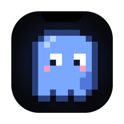
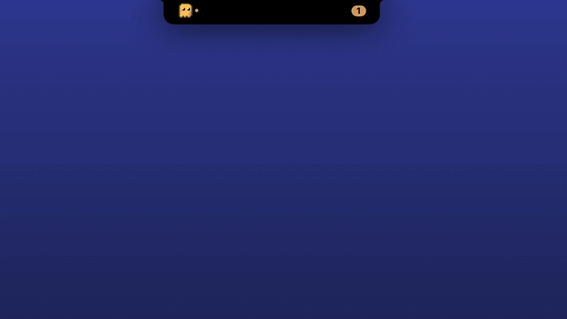
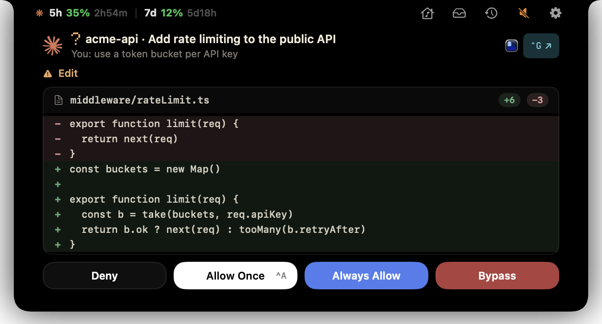
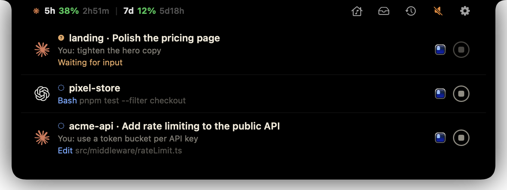

<div align="center">



# Vibe Notch

### Mission control for your AI coding agents — right in the notch.

Stop babysitting terminals. Approve, steer, and watch every agent
from the one place your eyes already go.

[](Package.swift)
[](#build-from-source)
[](#build-from-source)
[](LICENSE)
[](#privacy--security)
[](#contributing)



</div>

---

## The problem

You kick off Claude Code, switch to your browser, and three minutes later the
agent has been sitting on *"Can I run `pnpm install`?"* — waiting, in a buried
terminal tab, while you thought it was working.

**Vibe Notch puts that moment in the notch.** The permission card appears where
you're already looking; one click (or `^A`) and the agent is moving again.

## What you get

| | |
|---|---|
| **Zero babysitting** | Cards pop the instant an agent needs you — and *only* when you're not already looking at its terminal. |
| **Zero misclicks** | Dangerous commands (`rm -rf`, `sudo`, `curl \| sh`) are graded and flagged red before you click. Safe reads auto-approve silently. |
| **Zero context loss** | Answer questions, jump to the exact terminal tab, reply into the agent's pane, or stop a runaway turn — from the notch. |
| **Zero cloud** | Native Swift. Local socket. No accounts, no telemetry, no Electron. |

## See it

<div align="center">

**A permission, one glance away** — full command, risk-aware buttons, batch approve:



**Every session, live** — task, your last message, current tool, per-agent pixel marks:



</div>

## Everything else in the box

🔔 **Approve from the notch** — permission cards with the full command, its
diff (for file edits), and Deny / Allow / Bypass. Dangerous commands
(`rm -rf`, `sudo`, `curl | sh`…) are graded **high risk** and the card turns
red — you see what you're waving through.

👀 **Live session board** — every agent session with its task, your last
message, what it's running right now, a rolling console mirror, git branch,
and token usage.

❓ **Answer questions in place** — Claude's `AskUserQuestion` and Codex's
multiple-choice prompts (including the ones Codex queues behind `⇧←`) show up
as cards. Click an option or press `⌘1`–`⌘9`; "Something else…" takes free text.

⚡ **Act without switching** — jump to the exact terminal tab (`^G`), send a
quick reply ("continue", "yes", or your own text) straight into the agent's
pane, or **stop** the current turn with the same `Esc` the CLI uses — the
session stays alive.

🏷️ **Session names** — renames show up immediately: Claude's `/rename` titles
and Codex thread names replace the folder name in every row.

🕘 **Session history** — click the clock for past Claude *and* Codex sessions;
click one and a terminal opens running `claude --resume <id>` or
`codex resume <id>` in the right folder.

📁 **File tray** — drag a file toward the notch and the tray opens under your
cursor; drop it in, drag it out anywhere later. Images preview inline.

🎵 **Music & calendar** — what's playing (Music, Spotify, or a browser tab)
with play/pause and skip, plus this week and your next event.

🔍 **⌘K palette** — search across active sessions, history, and actions from
one field.

🛡️ **Guardrails** — screen-share guard queues cards silently while you're
presenting; smart suppression skips the popup when the agent's terminal is
already frontmost; per-project policies can lock strict repos to allow-once;
a safe-list auto-approves harmless reads (`git status`, `ls`, …).

📈 **Usage & escalation** — Claude 5h/7d rate-limit windows in the header;
unanswered requests re-chime, badge the menu bar, and (optionally) ping your
phone via [ntfy](https://ntfy.sh).

🖥️ **Remote Macs** — Settings › SSH lists every `Host` in `~/.ssh/config`;
pick one to watch its agents too.

🧪 **Labs** — localhost web dashboard, notch-over-lock-screen, and a
scriptable CLI (`vibenotch list|approve|deny|send|interrupt`).

## Supported agents

| Agent | Approvals | Activity | Config |
|---|:--:|:--:|---|
| Claude Code | ✅ | ✅ | `~/.claude/settings.json` |
| Codex | ✅ | ✅ | `~/.codex` (hooks) |
| OpenCode | ✅ | ✅ | plugin, `opencode.json` |
| Qwen · Droid · Kimi | ✅ | ✅ | Claude-schema / TOML |
| Cursor | — | ✅ | `~/.cursor/hooks.json` |
| Gemini CLI | — | ✅ | `~/.gemini/settings.json` |

On first launch a setup window shows the agents it found and connects them
when you say so — nothing is written to an agent's config before that. After
that, newly detected agents are wired automatically (switchable in Settings ›
CLI Hooks, where you can also toggle any agent off). Every config edit is
backed up and reversible.

## Install

### Download

Grab the latest `VibeNotch-x.y.z.dmg` from
[Releases](https://github.com/kaushal07wick/Vibe-Notch/releases) (the first
public release is on its way — until then, build from source), open it, and
drag **VibeNotch** to Applications.

> **Not notarized yet** (no Apple Developer ID). macOS quarantines the
> download and will say the app is damaged — right-click → Open does not get
> past that. Clear the quarantine flag once after installing:
>
> ```bash
> xattr -dr com.apple.quarantine /Applications/VibeNotch.app
> ```
>
> Building from source has no quarantine and needs none of this.

### Build from source

Requires macOS 14+, Apple Silicon, and the Swift 6 toolchain
(`xcode-select --install` is enough — no Xcode IDE needed).

```bash
git clone https://github.com/kaushal07wick/Vibe-Notch.git
cd Vibe-Notch
./scripts/bundle.sh release  # → .build/VibeNotch.app
open .build/VibeNotch.app
```

No Dock icon — the setup window opens on first launch to show you where the
app lives and which agents it found. Reopen it any time from the menu bar
(**✦ › Setup Guide…**).

### Try it without a real agent

```bash
./scripts/simulate.sh bash     # a Bash approval card (blocks until you decide)
./scripts/simulate.sh notify   # a "waiting" session row
```

## How it works

```
 your agent (Claude Code, …)          VibeNotch.app
 ───────────────────────────          ─────────────
  fires a hook ──► vibenotch-hook ──► unix socket ──► notch card
                   (tiny CLI)         ~/.vibenotch/     │ Approve / Deny
  ◄── decision JSON ◄── blocks on ◄── reply ◄──────────┘
```

- The hook is **fail-open**: if the app isn't running, agents behave exactly
  as they would without Vibe Notch. Nothing is ever blocked by us.
- Local Unix socket only — no TCP, no cloud, no telemetry.
- Answer in the terminal instead? The card notices and dismisses itself.

Full architecture notes live in [`docs/specs/`](docs/specs/).

## Keyboard

| Keys | Action |
|---|---|
| `^A` | Approve the front card |
| `^G` | Jump to the session's terminal tab |
| `⌘1`–`⌘9` | Pick an option on a question card |
| `⌘K` | Command palette (panel focused) |
| `Esc` | Collapse the panel |

## CLI

```bash
~/.vibenotch/bin/vibenotch list                 # sessions + pending, as JSON
~/.vibenotch/bin/vibenotch approve              # approve the front card
~/.vibenotch/bin/vibenotch send <session> "hi"  # type into that session
~/.vibenotch/bin/vibenotch interrupt <session>  # Esc: stop the turn, keep the session
```

Scriptable from Raycast, cron, or another Mac over SSH.

## Privacy & security

- **Local-first, always.** No accounts, no analytics, no outbound requests
  (the single exception: ntfy phone pings, off by default, to a topic you set).
- Approval decisions are yours: rules written by *Always Allow* live in your
  agent's own config; the safe-list and per-project policies are plain JSON
  under `~/.vibenotch/data` you can audit and edit.
- Screen-share guard keeps commands and prompts off your screen while
  presenting.
- Calendar and now-playing are read on your Mac and never leave it. macOS asks
  once for Calendar access; local builds keep a stable signing identity so it
  doesn't ask again after every rebuild.

## Uninstall

Menu bar → toggle each agent off (restores their original configs), quit the
app, then:

```bash
./scripts/uninstall.sh    # or: rm -rf ~/.vibenotch
```

## Contributing

PRs welcome — this is a community rebuild of a great idea, and the codebase is
deliberately small (Swift package, three targets, no Xcode project).

- `swift build && swift test` must stay green (`./scripts/bundle.sh` for the .app)
- One focused change per PR; match the surrounding style
- Agents are added via a single `AgentSpec` — see [`docs/`](docs/) and
  `Sources/VibeNotchCore/Agents/AgentSpec.swift`
- UI changes: attach a before/after screenshot

## License

[GPL-3.0](LICENSE) — free forever, improvements stay open.

## Acknowledgments

- [DynamicNotchKit](https://github.com/MrKai77/DynamicNotchKit) (MIT) — notch
  window, hover, and morph physics
- [Vibe Island](https://vibeisland.app) — the closed-source original that
  inspired this rebuild; [`open-vibe-island`](https://github.com/search?q=open-vibe-island)
  and [boring.notch](https://github.com/TheBoredTeam/boring.notch) for
  mechanism reference
- Departure Mono for the terminal blocks
- [mediaremote-adapter](https://github.com/ungive/mediaremote-adapter) for the
  `/usr/bin/perl` technique that still reads system now-playing on macOS 15.4+

The landing page lives in its own repo:
[vibe-notch-site](https://github.com/kaushal07wick/vibe-notch-site).
